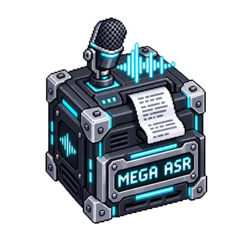

# MEGA ASR

[](media/cover.png)

<!-- block-metadata:start -->
[](model.json)
[](compatibility.json)
[](LICENSE)

Verified BloxSmith versions: **1.0.9** (bundled-block tests; see [test evidence](compatibility.json)).
<!-- block-metadata:end -->

## Role

Transcribe completed recordings locally using the **real MEGA-ASR engine**, its
Qwen3-ASR-1.7B base, official LoRA adapter and acoustic-quality router. This is not
a cloud API, a prompt sent to a coding agent, or an audio-stream transport block.
The original engine and weights stay separate from the block repository.

## Connect it

Send a local file path to **`audio`**, or connect **Save Audio → `recording_ready`
→ MEGA ASR**. Configure the permitted audio directory. WAV, Ogg/Opus, WebM/Opus,
FLAC, MP3, M4A and MP4 audio tracks are converted locally by FFmpeg to mono 16 kHz
PCM. Inputs must be completed files; microphone start/stop commands are not files.

| Output | Contents |
| --- | --- |
| `transcript` | Final nonempty text after every chunk succeeds. No incremental output. |
| `metadata` | Full text, input chunk spans, detected languages, routing decisions/probabilities, applied settings, model/engine revisions and source correlation/SHA-256. |
| `status` | `transcribed`, `no_text`, `error` or `cancelled`, with safe diagnostics. |

A recording event carries `event: "recording_ready"`, `recording_id`, `stream_id`,
absolute `path` and finalized `bytes`; optional `call_id` is preserved. Its byte
count must match the file. Deliberately delivering a request again transcribes
again; there is no durable exactly-once or deduplication claim.

Long files are split into **contiguous fixed-duration input chunks** (20 seconds
by default, at most 30 per chunk for the router). These boundaries may split
words: this is not VAD-aware or overlap-stitched long-form recognition. All input
samples are processed in order; over-limit recordings are refused, not truncated.
Chunk start/end values describe input spans, **not aligned word/phrase timestamps**.
No `segments` port invents alignment, and no diarization is claimed.

## Explicit offline setup

Requires Linux, FFmpeg, and a dedicated Python environment with the distributions
in `requirements.txt`. The current dependency set requires Python 3.11 or newer;
qualification uses Python 3.12 on x86-64. Choose CPU/CUDA PyTorch wheels appropriate
to the host, then install the remaining requirements in that environment. Nothing
installs into BloxSmith automatically. Set **Inference Python executable** to that
environment's Python; empty means the application's existing interpreter.

Prepare the approximately **4.8 GB** of upstream files explicitly:

```sh
python setup_model.py --directory MODEL_ASSET_DIRECTORY
```

Set **Model and engine directory** to that directory. The helper downloads only
declared public files at immutable revisions, verifies exact size and SHA-256,
and refuses insufficient disk space or corrupt existing assets. It never edits
a blueprint or replaces an existing file silently. Engine and model provenance
are listed in `model_artifacts.json`. A prepared directory can be copied to an
offline host. Model assets and environments do not belong in Git.

Run preparation and opening settings never download or load a model. Actual
transcription re-verifies assets, snapshots the declared engine modules into a
private job, and loads weights with local-only/offline settings and remote-code
loading disabled. Audio is never uploaded. No API key or login is needed.

Use a trusted asset directory which other users/processes cannot alter during
inference. Weight checks establish provenance, not an OS sandbox or protection
against arbitrary privileged concurrent filesystem changes. The configured Python
environment is trusted executable code, not an input-controlled command.

## Model controls and resources

- **Automatic acoustic adaptation** lets the official router choose base or
  LoRA-adapted inference for each chunk; **Always MEGA** forces the adapter.
  The degraded-audio probability is not confidence in the recognized text.
- Language can be automatic, English or Chinese (the explicitly declared MEGA
  training languages). Other languages inherited from the base model are not
  advertised as qualified MEGA capabilities here.
- Optional context/vocabulary is sent only to the speech model. It is never
  executed or treated as a downstream agent instruction.
- Bfloat16 is the memory-saving default. Float32 requires substantially more
  RAM; CPU bfloat16 can be slow on processors without native acceleration.
  CUDA selection fails explicitly if unavailable instead of silently using CPU.
- The model plus expanded LoRA deltas needs substantial RAM. The default
  16,384 MiB limit is **Linux process virtual address space**, not a memory
  reservation or a GPU-memory guarantee. Float32 exceeded this allowance on the
  qualification host. Adjust only for a machine with adequate resources.
- Whole-request time, threads, input size/duration, chunk size and output tokens
  are bounded. A chunk without a genuine end-of-sequence fails the whole request;
  a token-budget cutoff is never published as a final transcript.

Each activation owns one native inference process and loads the model once for
all chunks. It unloads after completion. This bounds retained resources but adds
load latency; there is no persistent GPU service, hidden request queue or live ASR.

## Runtime and UI

Both One Shot and Active Runtime perform real inference on an executed input.
The framework schedules events. Preparation alone is passive. Settings are shared
by modal and inspector, in English/French, with Apply/Cancel and draft-preserving
local tabs. Restart a prepared Run after editing settings.

Stop terminates the owned conversion/inference process group. A Linux guardian
also fences its children after abrupt framework-host termination. Original files
are never modified; normal jobs clean their private snapshots in the node storage
directory. An abrupt host kill may leave a private incomplete job directory for
manual cleanup, never a completed output. Model or input errors go to `status`
without intentionally failing the whole Run. Previous output history is not erased;
consumers must react to newly emitted events rather than assume cached data is new.

## Tests

The package owns unit, runtime and real-browser suites. They use synthetic speech,
the actual pinned CPU model, disposable framework instances and an explicitly
prepared private cache; no user's microphone, documents or provider account is used.
Set `MEGA_ASR_TEST_ASSETS` and `MEGA_ASR_TEST_PYTHON` to the offline fixture and its
inference interpreter before running the workspace harness. CUDA needs separate
hardware qualification. Recognition accuracy outside these fixtures is not certified.
Three suites passed against BloxSmith 1.0.9: actual forced-LoRA multi-chunk Ogg
transcription, automatic acoustic routing, both runtimes across bundled/managed/linked
origins, Stop during native model loading, and responsive English/French interfaces.
Duration-limit cases cover 8, 16, 44.1 and 48 kHz inputs after resampling, including
the extra-sample boundary. Modal and inspector screenshots were visually reviewed.
The proprietary test framework is not redistributed.

## License and upstream

Block code: Apache-2.0. The upstream model card declares Apache-2.0; the engine
README announces the same license. Upstream code, weights and Python dependencies
are downloaded/installed separately and retain their own notices and terms.

- [MEGA-ASR source and official inference](https://github.com/xzf-thu/Mega-ASR)
- [Official model card and weights](https://huggingface.co/zhifeixie/Mega-ASR)
- [Qwen3-ASR](https://github.com/QwenLM/Qwen3-ASR)
